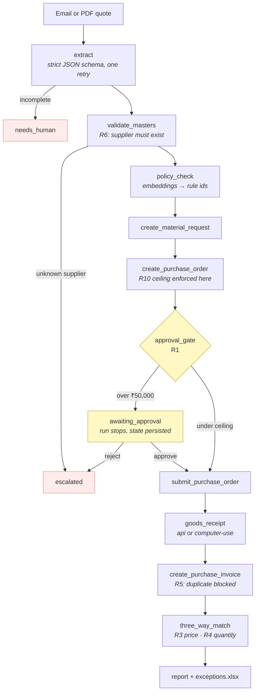

# ProcureFlow

**An AI agent that runs procure-to-pay inside a real ERP — and verifies its own work by reading every record back.**

[](https://github.com/Mr-Bathwal/procureflow/actions/workflows/ci.yml)


Drop in a messy purchase-request email or a supplier quote PDF. ProcureFlow
reads it, checks it against a written procurement policy, creates the
Material Request, builds the Purchase Order, **stops and waits for a human
if policy says so**, records the goods receipt and the invoice, runs a
three-way match, and exports the exceptions to Excel.

Every write is verified by reading the document back out of the ERP. Every
step is traced. Every decision cites the policy rule that caused it.

---

## Why read-back verification is the point

The interesting claim in agentic automation right now is that a model can
drive software built for humans. The uncomfortable part is that **a
successful-looking action is not a completed action**. An HTTP 200 means the
server accepted your request, not that the stored document says what you
believe it says — server-side defaults, naming series, currency conversion,
tax templates and validation hooks all run in between.

So every write in this project is followed by a read:

```python
doc = erp.insert("Purchase Order", payload, verify={"supplier": supplier})
# insert() re-reads the document from the server and compares.
# A mismatch raises VerificationError, which is its own exception type
# and is never folded into a generic "the ERP errored".
```

The test suite proves this catches drift, and one evaluation scenario
deliberately makes the ERP store a different supplier from the one that was
sent, purely to prove the check fires.

That matters most for **UI-driven agents**, where the gap between "the click
appeared to work" and "the record is correct" is widest. The goods-receipt
step is the one designed to run either through the API or through the
ERPNext web UI, and in both modes the result is confirmed through the REST
API afterwards.

---

## The flow



Eleven nodes, one direction, one place it stops. The order is fixed rather
than chosen by the model each turn, because you cannot receive against an
order you have not submitted — and ERPNext will refuse you if you try. What
the model contributes is **reading documents**. What the graph contributes is
never doing the steps out of order and never skipping the gate.

---

## Results

Produced by `python eval/run_eval.py`. **Every number below comes from a run
that actually executed**; nothing here is estimated.

| | v1 | v2 |
|---|---|---|
| Scenarios | 24 | 23 |
| **Task success rate** | **79.2%** (19/24) | **100%** (23/23) |
| Exception-detection rate | 66.7% | 100% |
| Avg steps per run | 7.3 | 8.3 |
| Latency p50 / p95 | 314 ms / 563 ms | 153 ms / 181 ms |

### What v1 → v2 actually was

The eval was not a scoreboard; it found real defects. Of the five v1
failures:

**Two were product bugs.**

1. *A rejected approval was never recorded as one.* The driver checked
   "has this been rejected?" after **every** node, so a pre-set rejection
   escalated the run immediately after `extract` — before `policy_check`
   ran. The trace then said "no approval required" for an order that had
   just been refused. The check now only takes effect at the gate.
2. *The fix for (1) silently did nothing.* `fn is self.n_approval_gate` is
   never true: Python builds a **new bound-method object** on every
   attribute access, so identity comparison always fails. The run fell
   through to `submit_purchase_order`, which refused it — the defence-in-depth
   guard caught the consequence while the cause went unnoticed. Comparing
   with `==` fixed it.

**Three were my scenarios being wrong.** Three quantity scenarios used a
₹74,400 order, which is over the R1 ceiling, so they stopped at the gate
before the three-way match ever ran. They were testing R4, not R1, so they
now approve and continue.

**One scenario was deleted, honestly.** `transient_error_is_retried` asserted
behaviour `FakeERPClient` cannot have: retry policy lives in the HTTP
transport, and the fake has no transport. It became two unit tests against
the real client with a stubbed transport — that a 5xx *is* retried and a 417
is *not* — which is a stronger test. That is why v2 has 23 scenarios and not
24.

> The honest headline: **79.2% → 100%, with two genuine bugs found by the
> harness and one scenario removed because it was testing the wrong thing.**

### What the 23 scenarios cover

Happy path under and over the approval threshold · approval rejected ·
approval pausing with no answer · preferred-supplier substitution · partial
receipt / qty short · qty over · qty inside tolerance · price variance
breaching and within tolerance · duplicate invoice · duplicate differing only
in punctuation · unknown supplier · messy email with typos and mixed units ·
multi-item PDF quote · missing quantity · ambiguous item · expedite flag ·
run-value ceiling · missing goods receipt · dry run · ERP validation error ·
read-back verification failure.

---

## Policy is a document, not code

No threshold is in the source. [`policy/procurement_policy.md`](policy/procurement_policy.md)
is the process, and the agent retrieves from it with embeddings (ChromaDB,
bundled MiniLM, no API key) and **cites the rule id in every decision**.

| Rule | Subject | Threshold |
|---|---|---|
| R1 | PO approval | > ₹50,000 needs a human |
| R2 | Preferred suppliers | propose, never substitute silently |
| R3 | Price variance | 5% **or** ₹500, whichever is **tighter** |
| R4 | Quantity variance | 2% **or** 1 unit, whichever is **greater** |
| R5 | Duplicate invoice | normalised match, never automatic |
| R6 | Unknown supplier | escalate; never create a supplier |
| R7 | Expedite | needed in < 2 days → flag, don't block |
| R8 | Authority | the list that is never automatic |
| R9 | Missing receipt | hold, don't reject |
| R10 | Run ceiling | > ₹5,00,000 stops, even with approval |

R3 and R4 combine their two limits **differently on purpose**: 5% of a ₹28
pair of gloves is ₹1.40, which costs more to investigate than to pay, while
2% of 10 units is 0.2 of a unit, which would make every single-unit
discrepancy an exception. Money is tightest at the small end; quantity is
not. Tests assert both directions.

Change ₹50,000 to ₹75,000 in the document and the next run behaves
differently — no code change, no redeploy. A test proves it.

---

## Guardrails

| Guard | What it stops |
|---|---|
| **Typed, allowlisted tools** | There is no `call_erp(url, body)`. The model can only invoke eight named functions. |
| **Doctype allowlist** | Writes limited to MR / PO / Receipt / Invoice. The agent **cannot create a Supplier** — that is the control point for bank details. |
| **Approval gate** | `submit_purchase_order` is unreachable except through it. Asserted against the node graph, not by reading the code. |
| **R10 run ceiling** | Checked immediately before the PO write, *below* the gate, so approval cannot waive it. Bounds what a bug can do, not just what a person decides. |
| **`--dry-run`** | A different object, not a flag checked at each call site. A scenario asserts zero writes. |
| **Read-back verification** | Its own exception type, never swallowed by a generic handler. |
| **Secret redaction** | Enforced in the tracer by key name *and* value shape, so a new node cannot leak a key by forgetting. |

Prompt injection is the reason for the first two rows: the agent reads PDFs
that arrive by email. A document that talks the model into "updating the
supplier bank account" hits a wall written in Python, not a sentence in a
system prompt asking it nicely.

---

## Run it

```bash
make setup           # venv + dependencies
make samples         # generate 12 emails and 3 quote PDFs
make test            # 80 offline tests, no ERP, no keys, ~3s
make eval            # 23 scenarios -> results.md + exceptions.xlsx
```

Everything above runs with **no ERPNext and no API key** — against
`FakeERPClient`, which reproduces naming series, server-recomputed fields,
mandatory-field validation and the draft/submit lifecycle. That is what makes
CI meaningful.

One request, end to end:

```bash
python -m procureflow.cli run seed/samples/req-happy.txt
```

The approval gate, across two processes:

```bash
python -m procureflow.cli run seed/samples/req-over-threshold.txt
python -m procureflow.cli approve <run_id> --note "ok for line 2 changeover"
```

### Against a real ERPNext

```bash
git clone https://github.com/frappe/frappe_docker && cd frappe_docker
docker compose -f pwd.yml up -d          # http://localhost:8080, Administrator/admin
```

Then generate API keys (*User → Administrator → API Access → Generate Keys*),
put them in `.env`, and:

```bash
make seed            # idempotent master data: 6 suppliers, 15 items, warehouse, price list
make eval-live
```

---

## Documentation

| | |
|---|---|
| [REQUIREMENTS.md](docs/REQUIREMENTS.md) | As-is vs to-be process, actors, business rules mapped to rule ids, acceptance criteria |
| [CONFIGURATION.md](docs/CONFIGURATION.md) | Every ERPNext module, master record and setting, and why each matters |
| [RUNBOOK.md](docs/RUNBOOK.md) | Cutover checklist, monitoring, the six failure modes and their fixes |
| [ARCHITECTURE.md](docs/ARCHITECTURE.md) | Components, state machine, the ERP boundary |

---

## Honest limitations

- **The documents are synthetic.** Twelve emails and three quote PDFs,
  generated by `seed/make_samples.py`. No real supplier or person appears.
- **The headline numbers were produced against `FakeERPClient`**, not a live
  ERPNext, and the results table says so in its own `mode` field. The fake
  reproduces the ERPNext behaviours that break naive integrations, but it is
  a test double. `make eval-live` runs the same scenarios against a real
  instance.
- **Extraction currently runs the deterministic parser**, not a model — the
  `extraction` field in `results.json` reads `heuristic`. The LLM path is
  implemented, schema-validated and retried, but the reported run did not
  use a key. A run with `LLM_API_KEY` set reports `llm` and is measured
  separately. **I would rather publish a heuristic number that is true than
  a model number that is borrowed.**
- **Computer-use mode is not shipped.** `computer_use.py` raises rather than
  silently falling back to the API, because a mode that quietly does
  something else is worse than one that is absent.
- Single company, single currency (INR), single buying price list.

---

## Stack

Python 3.11+ · LangGraph · pydantic · ChromaDB · ERPNext REST · httpx ·
rapidfuzz · pypdf · reportlab · openpyxl · FastAPI · pytest · ruff
