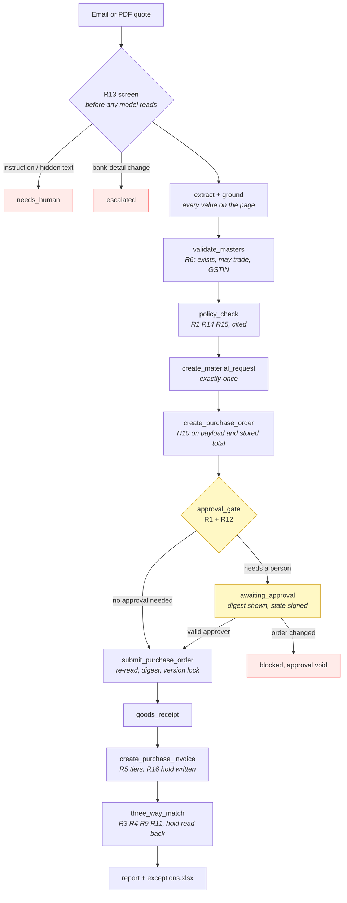

# ProcureFlow

**An AI agent that runs procure-to-pay inside ERPNext, and treats every one of its own actions, every document it reads and every approval it receives as something to verify, not trust.**

[](https://github.com/Mr-Bathwal/ERP/actions/workflows/ci.yml)


Drop in a purchase-request email or a supplier quote PDF. ProcureFlow reads
it, checks it against a written procurement policy of sixteen rules, raises
the Material Request and the Purchase Order in ERPNext, **stops for a named
approver with the authority to say yes**, records the goods receipt and the
invoice, runs a three-way match, and puts every exception on the invoice in
ERPNext as a hold.

The model only reads. Everything that decides is deterministic, in integer
paise, and cites the rule it applied.

---

## The idea: a successful-looking action is not a completed action

An HTTP 200 means ERPNext accepted a request, not that the stored document
says what the agent believes it says. For a computer-use agent the gap is
wider still: the click "worked". So ProcureFlow verifies at every boundary
where trust is usually assumed:

| Boundary | What is assumed elsewhere | What ProcureFlow checks |
|---|---|---|
| Its own writes | the response | Every document is read back and compared. `VerificationError` is its own type and never folded into a generic error. |
| The order's value | the request's figures | R1 and R10 are re-checked on the total ERPNext *stored*, line by line, because the server prices lines too. |
| A retry | that a timeout means "not written" | Every create carries an idempotency key in a unique ERPNext field; after an ambiguous failure the agent looks it up before re-sending. |
| An approval | that "yes" means yes to this order | The approval is bound to a SHA-256 digest of what the approver saw; the order is re-read and the submit is version-locked with ERPNext's own `modified` stamp. |
| The approver | that whoever clicked may approve | A delegation-of-authority table in the policy; the requester may not approve; an unknown requester fails closed. |
| The document | that the text is data | Screened before any model reads it (instructions, hidden PDF text, invisible Unicode, bank-change requests); every extracted value must be on the page. |
| The supplier | that the name exists | ERPNext's own hold, frozen and disabled flags, and a GSTIN that must pass its check character and match the master. |
| The audit trail | that the log is the log | Hash-chained, with each run's head anchored in the committed eval results. |

---

## Results

Produced by `python eval/run_eval.py`. Every number below comes from a run
that actually executed, against **FakeERPClient** (an in-memory ERPNext double)
with **heuristic extraction**. There is no live-ERPNext or LLM-extraction
result yet; see [Honest limits](#honest-limits).

| | v1 | v2 | **v3** |
|---|---|---|---|
| Scenarios | 24 | 23 | **48** |
| Task success | 79.2% (19/24) | 100% (23/23) | **100% (48/48)** |
| **False-touchless** (should have stopped for a person, did not) | n/a | n/a | **0 of 33** |
| Trace-invariant violations | n/a | n/a | **0** |
| Offline tests | 80 | 80 | **239** |
| Latency p50 / p95 | 314 / 563 ms | 180 / 232 ms | 172 / 217 ms |

Records: [`results-v1`](eval/results/results-v1.md) ·
[`results-v2`](eval/results/results-v2.md) ·
[`results-v3`](eval/results/results-v3.md). A tagged result is write-once.

**Why false-touchless is the headline.** Automation vendors publish
straight-through rates. The dangerous number is the opposite one: runs that
should have stopped for a person and went through. v3 reports it with its
denominator, alongside four invariants checked on every trace (no submit
without an approved gate, no write after a stop, no write in a dry run, no
citation of a rule that does not exist). Unit tests build traces that break
each invariant, so the checks are shown to fail. CI also diffs every
scenario's outcome, writes and steps against a frozen baseline, so a scenario
that keeps passing while doing one more write fails the build.

### What v2 to v3 was: an audit of my own agent

I read the v2 code as an auditor would, then ran eight research agents
(market ERPs, control failures, agent security, ERPNext and Indian
compliance, evaluation practice) and a skeptic over the working tree. Every
defect below was reproduced before it was fixed, and is pinned by a test or
a scenario:

- **An unpriced request went under every threshold.** A line with no stated
  rate was valued at ₹0, so 400 drums of hydraulic oil (₹74,60,000 at list)
  were auto-approved and submitted, under R1 *and* the R10 ceiling. ERPNext
  v15 fills a zero rate from the price list on save, so a live site would
  have stored the real value. Now every line is valued first (R14) and R10
  is checked on the stored total.
- **The three-way match was two two-way matches.** Nothing compared the
  invoice with the receipt: billing 70 for 60 delivered passed, and a line
  nobody ordered was never compared with anything (R11).
- **R11 then reused a unit allowance for money.** One undelivered drum,
  ₹18,650, billed in full, matched clean. It is now valued in paise.
- **Money went through binary floats.** `1.005` became 100 paise, and a
  delivery exactly on the 2% boundary was an exception. Now decimal
  throughout, with Hypothesis properties.
- **A retry could book the same order twice.** A timeout after the server
  committed was re-sent blind. Now exactly-once.
- **An approval was not bound to anything.** A draft edited while it waited
  was submitted with the old "yes". Now digest-bound and version-locked (R12).
- **Segregation of duties failed open.** With no sign-off, the requester was
  unknown and the check was skipped.
- **A full-width invoice number failed open.** `ＩＮＶ-００４２` normalised to
  an empty string, which the duplicate check read as "nothing to compare".
- **A read-back failure after approval was reported as "the ERP refused"**,
  through a second copy of the exception handlers.
- **`run_method` accepted any server path**, including Frappe's generic
  write methods, which walk round the doctype allowlist.
- **The trace wrote a resumed run's earlier steps twice**, and nothing
  pinned the policy a run was decided under.
- **Housekeeping that was really integrity:** the sample GSTINs all failed
  their check character; git's autocrlf was corrupting the sample PDFs on
  Windows checkouts; and the committed v1 record had been overwritten by a
  later run reusing its tag.

Each defect and its fix is its own commit in `git log e567695..HEAD`.

---

## The policy is a document, not code

[`policy/procurement_policy.md`](policy/procurement_policy.md) (v2.0) is the
process. Every threshold, window and the approver table are parsed from it;
if a sentence is reworded and stops parsing, the agent refuses to start
rather than run on defaults. Each run records the policy's version and hash,
and a run paused under one policy will not finish under another.

| Rule | Control | Loophole it closes |
|---|---|---|
| R1 | Approval above ₹50,000 | Large orders without a person |
| R2 | Preferred suppliers noted | Supplier sprawl |
| R3 | Invoice price vs order: 5% or ₹500, **tighter** | Price creep at invoice |
| R4 | Receipt qty vs order: 2% or 1 unit, **greater** | Short and over delivery |
| R5 | Duplicate invoices: normalised block, look-alike or same-amount hold | Duplicate payment, OCR and re-keying variants |
| R6 | Supplier exists, may trade, GSTIN valid and matches master | Ghost, held and impersonated suppliers |
| R7 | Expedite flag | Line-stop urgency made visible |
| R8 | The decisions that are never automatic | Authority, not arithmetic |
| R9 | Missing receipt: hold | Paying before goods arrive |
| R10 | ₹5,00,000 ceiling per run, below the gate | The blast radius of a bug |
| R11 | Invoice vs receipt, in money; unordered lines | Paying for goods not received |
| R12 | Approver authority, segregation, digest-bound approval | Self-approval, approval of a different order |
| R13 | Documents are data: screened and grounded | Prompt injection, hidden text, BEC bank changes, hallucinated values |
| R14 | Every line valued; quote vs buying price list | Inflated quotes, unpriced orders |
| R15 | Split orders: same supplier, 7 days, combined > R1 | Splitting to dodge approval |
| R16 | Every exception is a hold in ERPNext | Exceptions that live only in a spreadsheet |

R3 and R4 combine their limits differently on purpose, and the numbers in
R14 to R16 are the policy owner's proposals, not industry standards.

---

## The flow



Eleven nodes, one direction. The order is fixed rather than chosen by the
model each turn, because you cannot receive against an order you have not
submitted. What the model contributes is reading documents. What the graph
contributes is never doing the steps out of order and never skipping the
gate.

---

## How this compares with what the large suites document

From vendor documentation, read by the research agents. These are documented
behaviours, not tested claims.

| Capability | What SAP / Oracle / Dynamics 365 / ERPNext document | ProcureFlow |
|---|---|---|
| Approval tied to a document version | SAP restarts the workflow when a restart-relevant field changes; D365 returns an edited PO to draft | Digest of what was shown, re-read before submit, ERPNext `modified` lock on the PUT, plain-language diff when voided |
| Named holds | Oracle Payables and SAP keep named holds with a release path; ERPNext has `on_hold` | Every exception is written as a hold with rule ids and read back; the agent never releases one |
| Supplier blocks | SAP purchasing blocks; ERPNext Supplier hold, frozen, disabled | Read before any write; GSTIN check character and master match |
| Order-time price checks | Purchase agreement and blanket order pricing | R14 against the buying price list, for stated and missing rates |
| Untrusted documents | Oracle's quote agent creates drafts only; Microsoft layers spotlighting and classifiers | A deterministic screen before the model, grounding after it, adversarial scenarios |

---

## Run it

```bash
make setup           # venv + dependencies
make test            # 239 offline tests, no ERP, no keys
make eval            # 48 scenarios, diffed against the frozen baseline
python -m procureflow.cli run seed/samples/req-happy.txt
```

Approval across two processes, as an approver from the policy's table:

```bash
python -m procureflow.cli run seed/samples/req-over-threshold.txt
python -m procureflow.cli approve <run_id> --as proc.manager --note "ok"
python -m procureflow.cli verify-trace <run_id>
```

Operational switches: `PROCUREFLOW_WRITES=off` refuses every ERP write. The
API (`make api`) takes identity from bearer tokens in `PF_API_TOKENS` and
refuses all writes when none are configured. See
[`.env.example`](.env.example).

### Against a real ERPNext

```bash
git clone https://github.com/frappe/frappe_docker && cd frappe_docker
docker compose -f pwd.yml up -d          # http://localhost:8080
```

Generate API keys, put them in `.env`, then `make seed` (idempotent: masters,
price list, and the unique `procureflow_key` custom field) and `make
eval-live`. Live numbers will be published alongside the fake ones, never in
place of them.

---

## Honest limits

- **No live ERPNext run yet.** Every result is against `FakeERPClient`,
  which reproduces naming series, server-side pricing, the draft/submit
  lifecycle, unique keys, `modified` version checks, supplier holds and
  ERPNext's over-receipt refusal, but is a test double.
- **Extraction ran the deterministic parser** (`extraction: heuristic`).
  The LLM path is implemented, schema-validated, screened and grounded, but
  the published run used no model. No LLM accuracy is claimed.
- **There is no supplier-invoice intake yet.** The invoice is generated from
  the order, and its number is labelled `SIM-…` unless one is supplied, so
  R3, R5 and R11 are exercised by scenarios, not by real supplier invoices.
- **The documented ERPNext setup still uses Administrator API keys.**
  Least-privilege roles per stage are designed, not built.
- **Screening covers PDFs and plain text.** HTML and MIME email parts are
  not screened for hidden content.
- **R5 and R15 read the ledger, then write, without a lock**, so two
  concurrent runs could both pass. ERPNext's supplier-invoice uniqueness
  setting is the documented backstop.
- **Not claimed:** fraud prevention, immunity to prompt injection, any
  compliance certification, OCR, payments. The suite shows named patterns
  stopped, under stated conditions.
- Synthetic documents (23 emails, 5 quote PDFs); one company, INR, one
  buying price list. Computer-use receipt mode is not shipped, and says so.

---

## Documentation

| | |
|---|---|
| [ARCHITECTURE.md](docs/ARCHITECTURE.md) | Components, where each control lives, exactly-once, the trace |
| [CONFIGURATION.md](docs/CONFIGURATION.md) | Every ERPNext setting, custom field and environment variable, and why |
| [RUNBOOK.md](docs/RUNBOOK.md) | Approvals, holds, quarantines, the kill switch, the eval baseline |
| [REQUIREMENTS.md](docs/REQUIREMENTS.md) | Business rules, acceptance criteria, rule-to-test traceability |

---

## Stack

Python 3.11+ · LangGraph · pydantic · ChromaDB · ERPNext/Frappe REST · httpx ·
FastAPI · pypdf · reportlab · openpyxl · rapidfuzz · pytest · Hypothesis ·
ruff · GitHub Actions
