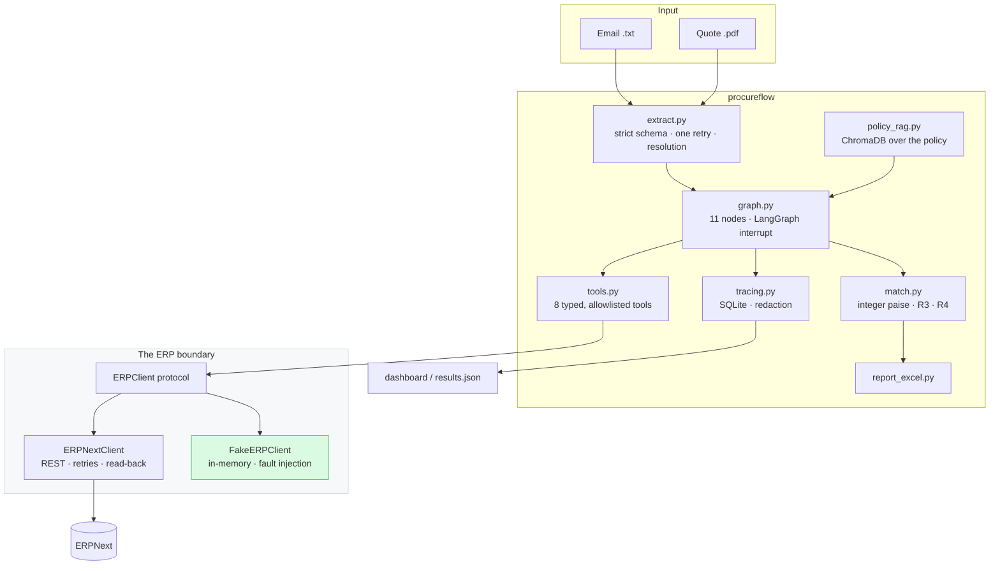

# Architecture

## The boundary is the design

`ERPClient` is a `Protocol` with two implementations. Everything above it —
the graph, the rules, the match, the report — has never been told which one
it is holding. That buys three things:

1. **CI runs with no ERP, no network and no credentials**, in about three
   seconds.
2. **`--dry-run` is a different object**, not a flag threaded through a
   hundred call sites where one of them can be forgotten.
3. The agent can be developed, and its failures reproduced, while the ERP is
   down — which, during an implementation, it frequently is.

`FakeERPClient` is not a stub that always succeeds. A fake that always
succeeds is worse than no fake, because it lets you write an agent that only
works when nothing goes wrong. This one reproduces naming series,
server-recomputed amounts, mandatory-field validation, the draft/submit
lifecycle, and the refusal to map from a draft document. It can also be told
to fail on command, which is how the retry and escalate paths are tested
deterministically instead of by hoping a real server misbehaves during a
test run.

## Why the sequence is fixed

A conversational agent that decides its own next tool call is the wrong
shape for a finance process. You cannot receive against an order you have
not submitted, and ERPNext will refuse you if you try.

So the eleven nodes run in one order. The model's contribution is **reading
documents**; the graph's contribution is **never reordering the steps and
never skipping the gate**. `submit_purchase_order` is reachable only through
`approval_gate`, and a test asserts that against the node graph rather than
by reading the code and believing it.

## Where each guard lives, and why there

| Guard | Module | Why there |
|---|---|---|
| Doctype allowlist | `erp/client.py` **and** `tools.py` | two cheap checks on either side of a boundary |
| Dry run | `tools.py` | one place, so a new node cannot forget it |
| R10 run ceiling | `tools.create_purchase_order` | immediately before the write, *below* the gate, so approval cannot waive it |
| Read-back verification | `erp/client.py` | the same code path that performs the write |
| Secret redaction | `tracing.py` | on the way to disk, not at each call site |
| Never-automatic rules | `policy_rag.ALWAYS_APPLICABLE` | retrieval must not be able to switch off a control |

## State and resumption

A run that pauses at the gate is genuinely stopped: its state is serialised
and the process exits. `procureflow approve <id>` is a **separate
invocation**, which is the point — an approval that only works inside one
Python process is not an approval, it is a prompt.

Against a live ERPNext the draft order lives on the server, so only the run
state needs persisting. In fake mode the ERP is in memory, so it is pickled
alongside the run; `FakeERPClient` implements `__getstate__`/`__setstate__`
to rebuild its naming-series counters, which keeps document numbers moving
forward instead of restarting and colliding.
