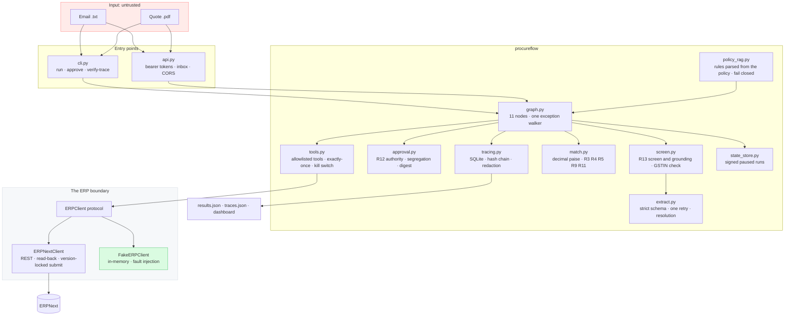

# Architecture

This describes v3: policy v2.0, rules R1 to R16. The flow is the same eleven
nodes as v2. What changed is what each node checks before it writes, and
what the system can prove afterwards.

---

## The boundary is the design

`ERPClient` is a `Protocol` with two implementations. Everything above it —
the graph, the rules, the match, the report — has never been told which one
it is holding. That buys three things:

1. **The tests and the CI eval run with no ERP and no credentials.**
2. **`--dry-run` is a different code path at the tool boundary**, not a
   flag threaded through a hundred call sites where one of them can be
   forgotten.
3. The agent can be developed, and its failures reproduced, while the ERP is
   down — which, during an implementation, it frequently is.

`FakeERPClient` is not a stub that always succeeds. A fake that always
succeeds is worse than no fake, because it lets you write an agent that only
works when nothing goes wrong. This one reproduces the ERPNext behaviours
that break naive integration code:

- naming series, server-recomputed amounts, mandatory fields;
- the draft/submit lifecycle, and the refusal to map from a draft;
- a unique `procureflow_key`, refused with a 409 on a second insert;
- a fault that fires **after** the write has committed, the way a gateway
  timeout loses the response to a request the server finished;
- a `modified` stamp bumped on every save, and the refusal of a save that
  carries a stale one;
- the refusal of an order or invoice to a supplier on hold;
- the refusal of a receipt above its order, with the over-delivery
  allowance at ERPNext's default of 0% unless a scenario states otherwise.

It is still a test double. It knows nothing about accounting, tax or stock
ledgers, and every result in this repository was produced against it. See
[Deferred, not claimed](#deferred-not-claimed).

---

## The flow: eleven nodes, one direction

Unchanged from v2.

| # | Node | Writes to ERPNext | Can stop the run with |
|---|---|---|---|
| 1 | `extract` | nothing | R13 quarantine or escalation; R13 ungrounded value; R8 incomplete request |
| 2 | `validate_masters` | nothing | R6 escalation (missing, disabled, frozen, on hold); R6 GSTIN that fails its check or is not the master's |
| 3 | `policy_check` | nothing | R14 unpriced line. Decides whether R1, R14 or R15 need an approver |
| 4 | `create_material_request` | Material Request, created and submitted | ERP refusal; read-back failure |
| 5 | `create_purchase_order` | Purchase Order, **draft** | R10 ceiling; total or line read-back failure |
| 6 | `approval_gate` | nothing | pause for approval; R12 refusal; rejection |
| 7 | `submit_purchase_order` | Purchase Order submit | R12 void (order changed); version-lock refusal |
| 8 | `goods_receipt` | Purchase Receipt, created and submitted | ERPNext's over-receipt refusal |
| 9 | `create_purchase_invoice` | Purchase Invoice, **draft**, held if any exception | R5 duplicate; R5 unreadable number |
| 10 | `three_way_match` | nothing | R16 hold that disagrees with the match |
| 11 | `report` | nothing | — sets the final state |

The agent never submits a Purchase Invoice. It records the invoice as a
draft, with a hold when the match found anything, and accounts take it from
there.

### Why the sequence is fixed

A conversational agent that decides its own next tool call is the wrong
shape for a finance process. You cannot receive against an order you have
not submitted, and ERPNext will refuse you if you try.

So the eleven nodes run in one order. The model's contribution is **reading
documents**; the graph's contribution is **never reordering the steps and
never skipping the gate**. `submit_purchase_order` is reachable only through
`approval_gate`, and a test asserts that against the node order rather than
by reading the code and believing it.

---

## Controls map

Where each rule is enforced, and what happens when it fires. Every rule is
written in [`policy/procurement_policy.md`](../policy/procurement_policy.md),
and the thresholds are parsed from it strictly: a number that cannot be read
stops the agent from starting (see
[how the policy is parsed](#guards-that-are-not-a-numbered-rule)).

| Rule | Enforced in | What is checked | When it fires |
|---|---|---|---|
| **R13**, before the model | `graph.n_extract` → `screen.screen` | Text addressed to an automated reader or asking for a control to be skipped. Text a person cannot see: PDF invisible render mode, type under the policy's 2 pt, white text not drawn over a dark fill. Invisible Unicode. A request to change bank or payment details. | `needs_human` (quarantined), or `escalated` for a payment change. No model call is made and nothing is written. |
| **R13**, after the model | `graph.n_extract` → `screen.ground` | Every value read — supplier, each line's description, quantity and rate, needed-by date, supplier reference, printed GSTIN, requester — must appear in the document. | `needs_human`. The value is never used. |
| **R8**, extraction | `graph.n_extract` | The request is complete and every line resolved to a catalogue item. | `needs_human`, citing R8. Nothing is guessed. |
| **R6** | `graph.n_validate_masters` | The supplier exists by exact name. The Supplier record is read: `disabled`, `is_frozen`, and `on_hold` with `hold_type` All or Invoices and no `release_date` or one still ahead. A printed GSTIN must pass its structure and check character (`screen.gstin_problem`) and equal the master's. | `escalated` before any write; `needs_human` for a GSTIN problem. A payments-only hold is cited and the run continues. |
| **R14** | `graph.n_policy_check` | Every line is valued at its stated rate or, failing that, the buying price list (`PF_PRICE_LIST`), before any threshold applies. A stated rate is compared with the list. | `needs_human` if a line has neither a rate nor a list price. Approval required, whatever the value, if a stated rate is above the list by more than R3's tolerance. |
| **R1** | `graph.n_policy_check`, then `n_approval_gate` | The order value, in integer paise, against the threshold. | The run pauses `awaiting_approval`. |
| **R15** | `graph.n_policy_check` (`_recent_orders`) | Orders to the same supplier in the 7 days before, not cancelled, plus this one, against R1. | Approval required, with the related orders named. |
| **R2**, **R7** | `graph.n_policy_check` | Preferred supplier; needed-by date. | Noted or flagged. Never a stop. |
| **R10** | `tools.create_purchase_order` | The payload total before the write. After the insert, the **stored** total read back (within one paisa a line) and the stored lines read back by item and quantity. The stored total against the ceiling again. | `blocked` before any order exists; or `needs_human` (read-back) / `blocked` with the order left a draft. Approval cannot waive it. |
| **R12** | `graph.n_approval_gate` (`approval.check_approval`) | The approver is in the delegation-of-authority table and within their limit. The approver is not the requester — the document's sign-off or the authenticated submitter; with neither known, the approval is not accepted. A SHA-256 digest of the order is recorded the first time the gate sees it. | Refused: the run stays `awaiting_approval` for a valid approver. |
| **R12**, at submit | `graph.n_submit_purchase_order` | The order is read back and its digest recomputed. The submit carries the `modified` stamp of the order just read. After the submit, the submitted order's digest is checked against the approval once more. | A changed order is `blocked` and the approval void, with the change named. A save landing between read and submit is refused by ERPNext itself; if the order is still a draft the run stops `needs_human`. A submitted order that does not match the approval stops `needs_human`. |
| **R5**, exact | `graph.n_create_purchase_invoice` (`match.find_duplicate_invoice`) | The supplier's invoice number, NFKC-folded, alphanumerics only, leading zeros dropped, against that supplier's booked invoices. | `blocked` before the invoice is written. A number that normalises to nothing stops `needs_human`. |
| **R5**, near | `match.find_possible_duplicates` | Within 30 days: a number equal once look-alike characters and leading zeros are set aside, or a different number for exactly the same amount. | `possible_duplicate`, held. |
| **R3**, **R4**, **R9**, **R11** | `match.three_way_match`, run on the invoice payload before the insert and on the stored invoice after it | Price per line against the order (R3). Receipt against order (R4). No receipt (R9). Invoice against receipt, valued in money at the order's rate, and any invoiced item not on the order (R11). | `completed_with_exceptions`. |
| **R16** | `n_create_purchase_invoice` → `tools.create_purchase_invoice`; checked in `n_three_way_match` | Any exception sets `on_hold = 1` and a deterministic `hold_comment` (policy version, then rule, exception, item and variance for each), written with the invoice in one insert. `on_hold`, and `hold_comment` when held, are in the read-back. The match on the stored invoice must agree with the hold. | Every hold written is a decision and cites R16, with the hold comment as its detail. A dropped hold, or a hold on a clean invoice, is a verification failure: `needs_human`. |
| **R8**, the rest | `Agent._walk`, `Agent.resume`, `tools._guard_writes` | A read-back failure; a paused run whose policy changed; a write while writes are off. | `needs_human`, `needs_human`, `blocked`. |

Two of these need a plain note. **R9** is reached only when no receipt
exists, and today the run always records a receipt before the invoice; it is
exercised by a scenario that skips the receipt. **R3, R5 and R11** run on an
invoice the agent generates from the order (see
[Deferred](#deferred-not-claimed)), so they are exercised by scenarios that
state what the supplier billed, not by real supplier invoices.

### Guards that are not a numbered rule

| Guard | Where | Why there |
|---|---|---|
| Doctype allowlist | `erp/client.py` and `erp/fake.py` **and** `tools.py` | two cheap checks on either side of a boundary |
| Server-method allowlist | `erp/client.guard_method` | only ERPNext's three document mappers. Frappe's generic write methods (`frappe.client.set_value`) would otherwise walk round the doctype allowlist |
| Dry run | `tools.py` | one place, so a new node cannot forget it |
| Kill switch, `PROCUREFLOW_WRITES=off` | `tools._guard_writes`, at every write | at the tool boundary, read at call time, so no node can route round it |
| Always-applicable rules | `policy_rag.ALWAYS_APPLICABLE`: R5, R6, R8, R10, R12, R13 | retrieval must not be able to switch off a control |
| Policy parse fails closed | `policy_rag.read_numbers`, then `Agent.__init__` → `verify_numbers` | a reworded policy must stop the agent, not run it on defaults held in code |
| Secret redaction | `tracing.redact` | on the way to disk, not at each call site |

**How the policy is parsed.** `read_numbers` reads each number only from the
rule's operative text — its rationale blockquotes are excluded — and only by
the exact bold phrase the policy uses for it:

| Rule | Phrase |
|---|---|
| R1 | `**above ₹X**` |
| R3 | `**N%**` and `**₹X per line**` |
| R4 | `**N%**` and `**N unit**` (or `units`) |
| R7 | `**fewer than N calendar days**` |
| R10 | `**₹X**` |
| R13 | `**N pt**` |
| R5, R15 | `**N days**` |

A number it cannot find is recorded in `PolicyNumbers.missing`, never
replaced by a default. R1's amount must also agree with R1's row in the
summary table. `verify_numbers` turns anything missing or disagreeing into a
complaint, alongside its other checks (R2 names two companies, R12's table
parses, an approver's limit reaches R10, R10 is above R1, values are in
range), and the agent raises `PolicyError` naming the rule. It refuses to
start rather than guess.

This was not true in v3's first cut. The parse took the first rupee amount
anywhere in a rule, so a reworded R3 cash cap read the ₹28 pair of gloves
from R3's own rationale, a reworded R1 fell back to ₹50,000 without a word,
and R7 had always fallen back to its default, because its bold phrase begins
"fewer than". Tests now reword each of these and assert the agent refuses
to start.

---

## Exactly-once writes

A timeout does not mean the document was not created. The server may have
committed it and lost the response. v2 retried a create on a timeout or a
5xx, and that is how an integration books a second Purchase Order.

**The transport never re-sends a create.** `ERPNextClient._request` sends a
POST once (`retry=False`), and the submit `PUT` once too. Only reads are
retried on timeouts, connection errors and 5xx, with backoff. A 4xx is never
retried.

**Every created document carries a key.** `tools.idempotency_key` gives
`pf-<run id>-<step>`, with one step name each for the Material Request,
Purchase Order, Purchase Receipt and Purchase Invoice. The key goes into the
`procureflow_key` custom field, which is unique, so the database itself
refuses a second document with the same key. See
[CONFIGURATION.md](CONFIGURATION.md#8-custom-field-procureflow_key).

**`tools.insert_exactly_once` reconciles before it re-sends.** After an
ambiguous failure — no status, a 5xx, or a 409 on the key — it looks the
document up by key:

- found once: the earlier attempt committed. The document is adopted and
  verified against what was sent, like any other.
- not found: re-sending is safe.
- found twice: impossible on a seeded site, so it is a verification
  failure, not a choice between them.

A 417 is not ambiguous. ERPNext refused the document and wrote nothing, so
it is never retried.

**`tools.submit_exactly_once` asks the document.** A lost submit response,
"already submitted", or a refusal because the order was modified since it
was read, is settled by reading `docstatus`:

- `docstatus` 1: the order was submitted, by an earlier attempt whose answer
  was lost. That is confirmed, not refused. The graph then checks the
  submitted order's digest against the approval, so an order that is
  submitted but is not what was approved stops `needs_human`.
- still a draft, after a stale-`modified` refusal: someone saved the order
  between the read-back and the submit. That is the version lock working,
  and it is a verification failure, not a retry.

The submit is not retried by the transport because a retry after a lost
answer carries a `modified` stamp that is already stale, and would be
refused although the first submit went through.

What this does not cover: the key is per run. Re-running the same request
is a new run, with new keys and new documents. R5 is what stops a second
invoice for the same supplier invoice number. And R5 and R15 read the ledger
and then write, without a lock, so two runs at the same moment could both
pass.

---

## One exception walker

`Agent.run` and `Agent.resume` both go through `Agent._walk`, which is the
only place an exception becomes an outcome:

| Raised | Outcome |
|---|---|
| `ToolRefused` | `blocked`, citing the rule the refusal enforces (R10, or R8 for the kill switch) |
| `VerificationError` | `needs_human`, citing R8: "read-back verification failed" |
| `ERPError` | `needs_human`: "the ERP refused", with ERPNext's own message unwrapped from its HTML |
| anything else | `failed`: a defect, not a decision |

The trace is finished in a `finally`, whatever happened.

v2 had two copies of these handlers. The resume copy had no
`VerificationError` branch, so a read-back failure after approval was
reported as "the ERP refused". A second copy of a safety rule is the one
that drifts, and a test now asserts there is exactly one of each branch.

---

## The trace: one row per step, hash-chained, anchored

Traces are SQLite: a `runs` row per run and a `steps` row per node. SQLite
rather than a log file, because traces are queried — which runs escalated
and why, p95 by node — and grep answers none of that.

**One row per step.** `(run_id, seq)` is unique and written with `INSERT OR
REPLACE`. v2 re-inserted a paused run's earlier steps when it resumed, so a
resumed run had more rows than steps. An older trace file is migrated and
de-duplicated on first open.

**A hash chain.** Each step row carries `prev_hash` and `hash`. The first
link is the SHA-256 of the run id and the policy's SHA-256; each hash covers
the previous hash and the step row as stored. The last link is the run's
verdict — its state, reason and cited rules — so editing what a run
concluded breaks the chain as surely as editing a step. The run row keeps
the head, the policy version and the policy hash. `procureflow verify-trace
<run>` recomputes the chain and names the first step, or the verdict, that
no longer matches.

**An external anchor.** Someone with write access to the file can rewrite
the whole chain consistently, head included. So the eval writes every run's
`run_id` and `trace_head` into its results file; a published tag's
`results.json` is committed. `verify-trace <run> --against
eval/results/results.json` compares the recomputed head with that record,
and git history is the anchor. A run that has no head in the file given is
reported `BROKEN`, not `intact`.

What it does not cover, stated plainly:

- Only eval runs have an anchored head. A CLI or API run is checked for
  internal consistency alone.
- The eval writes to its own file, `eval/results/traces-eval.sqlite`, which
  is git-ignored and recreated on every eval run, scratch runs included. A
  published record can be verified only on the machine that produced it,
  and only until the next eval run there.
- Redaction happens before hashing, so the chain proves what was stored,
  not what was redacted out of it.
- A trace written before the verdict joined the chain does not verify under
  the current code. That is a format change, not tampering.

CLI and API runs go to `PF_TRACE_DB`.

---

## Paused runs: signed on disk, pinned to their policy

A run that pauses at the gate is genuinely stopped: its state is written to
disk and the process exits. `procureflow approve <run>` is a **separate
invocation**, which is the point — an approval that only works inside one
Python process is not an approval, it is a prompt.

**Signed.** A paused run is `MAGIC || HMAC-SHA256(key, body) || body` in
`eval/results/paused/<run id>.pkl`. The MAC is checked in constant time
before a single byte is unpickled, because unpickling executes code and the
file carries the order value, the approval checks and the digest. An edited
or unsigned file is refused. The key is `PF_STATE_KEY`, or one generated
into `eval/results/paused/.state.key` (git-ignored). This makes tampering by
anyone without the key detectable. It is not encryption, and whoever holds
the key can still forge a state.

**Never re-snapshotted.** The gate records the order digest the first time
it sees the order. A resume does not take a new one, or an edit made while
the run waited would be laundered into the approval.

**Pinned.** Every run records the policy version (from the document's
header) and the SHA-256 of the parsed rules. A run resumed under a different
policy stops `needs_human` (R8) instead of finishing under rules nobody
approved it against.

Against a live ERPNext the draft order lives on the server, so only the run
state is persisted. Against the fake the ERP is in memory, so it is pickled
with the run; `FakeERPClient` stores its naming-series counters as integers
so document numbers keep moving forward after a resume.

---

## The trust boundary

### The API

`procureflow/api.py`, served with uvicorn.

- **Identity comes from `Authorization: Bearer <token>`**, never from the
  request body. `PF_API_TOKENS` maps tokens to identities, compared in
  constant time. With no tokens configured, every write endpoint returns
  401: the API fails closed.
- **`POST /runs`** takes no auto-approve flag and no approver. The token's
  identity becomes the run's submitter, which R12 uses for segregation of
  duties.
- **`POST /runs/{id}/approve` and `/reject`** act as the token's identity.
  The body carries a note and nothing else that matters. A requester's token
  cannot approve their own run, whatever the body says.
- **Sources are names inside `PF_INBOX`.** A path that resolves outside it,
  or a symbolic link, is refused with a 400. Without this, any caller could
  point the API at a file on the server and send its text to the LLM
  provider and into the trace.
- **CORS** allows only `PF_CORS_ORIGINS` (the dashboard), `GET` and `POST`,
  and the `Authorization` and `Content-Type` headers.
- **Reads stay open**: `/health`, `/policy`, `/permissions`, `/results`, and
  `GET /runs`, which lists the runs this process started, with supplier,
  value and citations. Keep the API on a trusted network.
- **Not provided**: TLS, token expiry or rotation, rate limits. Put it
  behind a TLS-terminating proxy if it leaves the machine.
- The API reads the policy once per process. Restart it after a policy
  change.

### The CLI

The CLI trusts its operator. The submitter is the operating-system login
(or `--requester`), and the approver is whatever `--as` names. Nothing
authenticates `--as`; access to the machine and to the state key is the
boundary. Where approvers must be authenticated, approve through the API.

---

## Deferred, not claimed

- **Supplier-invoice intake.** There is none. The Purchase Invoice is
  generated from the order, and its supplier invoice number is
  `SIM-<run id>` unless one is given; the trace records that it was
  simulated.
- **Header and GST total matching.** The three-way match compares lines:
  item, quantity and rate. It does not compare invoice header totals, taxes,
  GST or charges.
- **Least-privilege ERPNext roles.** The documented setup still uses
  Administrator API keys. See
  [CONFIGURATION.md](CONFIGURATION.md#12-api-access-the-known-gap).
- **Live ERPNext runs.** There is no live result. The v3 record
  (`eval/results/results-v3.md`) is 48/48 scenarios, 0 false-touchless of
  33, 0 trace-invariant violations — against FakeERPClient, synthetic corpus,
  with heuristic extraction. There is no LLM extraction result either.

Other limits worth knowing: R13 screens PDFs and plain text, not HTML or
MIME email parts. Computer-use receipt mode raises rather than running. And
none of this is a claim of fraud prevention, immunity to prompt injection,
any compliance certification (SOX, SOC 2, GST), OCR, payments or invoice
intake. The suite shows named patterns stopped, under stated conditions.
