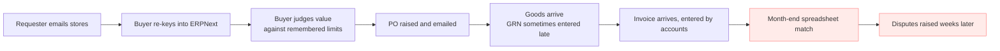
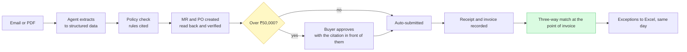

# Requirements — procure-to-pay automation

**Client:** ProcureFlow Demo Pvt Ltd — mid-size instruments manufacturer, Bengaluru
**Scope:** indirect and raw-material purchasing routed through ERPNext
**Author:** Gourav Kumar Bathwal · v1.0

---

## 1. Business context

Purchasing today starts as free text. A production planner emails stores, or
forwards a supplier's quotation PDF, and a buyer re-keys it into the ERP.
That re-keying is the whole problem:

- It is slow, and the buyer is the bottleneck for every line.
- It is where transcription errors enter, and a transcription error in a
  rate is a payment error.
- It is **invisible**. Nothing records why an order was raised against one
  supplier rather than another, or who decided a 6% price rise was
  acceptable.

The three-way match is run at month end against a spreadsheet, so a short
delivery is typically discovered after the invoice has been approved.

## 2. As-is

**Pain:** the match is detective, not preventive. By the time a variance is
found the relationship conversation is harder and the money may have moved.

## 3. To-be

**The change that matters:** the match moves from month-end to the moment the
invoice is recorded, and the buyer's attention moves from typing to deciding.

## 4. Actors

| Actor | Does | Needs from the system |
|---|---|---|
| **Requester** (production planning) | sends the request | not to learn the ERP |
| **Buyer** | approves above ₹50,000 | the value, the variance and the rule, on one screen |
| **Stores** | receives goods, raises the GRN | partial receipts to be ordinary, not an error |
| **Accounts** | books and pays invoices | duplicates blocked before entry, not after |
| **Financial controller** | owns the policy | to change a threshold without a developer |
| **ProcureFlow (the agent)** | everything between | a bounded permission surface |

## 5. Business rules

Every rule is in [`policy/procurement_policy.md`](../policy/procurement_policy.md)
with the reason it is the number it is. The agent cites the id on each
decision, so a trace row maps to a sentence a human wrote.

| Id | Rule | Where enforced |
|---|---|---|
| R1 | PO > ₹50,000 needs approval | `graph.n_policy_check`, `n_approval_gate` |
| R2 | Prefer preferred suppliers | `graph.n_policy_check` |
| R3 | Price variance 5% or ₹500, tighter | `match.Tolerances.price_limit` |
| R4 | Qty variance 2% or 1 unit, greater | `match.Tolerances.qty_limit` |
| R5 | No duplicate supplier invoice | `match.find_duplicate_invoice` |
| R6 | Unknown supplier escalates | `graph.n_validate_masters` |
| R7 | Expedite under 2 days | `config.PurchaseRequest.needs_expedite` |
| R8 | Never-automatic list | `policy_rag.ALWAYS_APPLICABLE` |
| R9 | Missing receipt is held | `match.three_way_match` |
| R10 | Run ceiling ₹5,00,000 | `tools.create_purchase_order` |

## 6. Acceptance criteria

Each maps to a scenario in `eval/scenarios/`, so "accepted" is a test result
rather than an opinion.

| # | Given | Then | Scenario |
|---|---|---|---|
| 1 | a clean request under ₹50,000 | four documents created, no human | `happy_under_threshold` |
| 2 | a request over ₹50,000 | run pauses; PO stays draft | `approval_pauses_without_answer` |
| 3 | approval granted | PO submits, flow completes | `happy_over_threshold` |
| 4 | approval refused | escalated; PO never submitted | `approval_rejected` |
| 5 | 45 of 60 received | `qty_short`, citing R4 | `partial_receipt_qty_short` |
| 6 | 59 of 60 received | no exception | `qty_within_tolerance` |
| 7 | billed ₹4,700 against ₹4,320 | `price_variance`, citing R3 | `price_variance_breach` |
| 8 | billed ₹4,400 against ₹4,320 | no exception | `price_variance_within_tolerance` |
| 9 | invoice number re-used | blocked before any write | `duplicate_invoice_blocked` |
| 10 | same number, different punctuation | still blocked | `duplicate_invoice_different_punctuation` |
| 11 | supplier not in the master | escalated, nothing created | `unknown_supplier_escalated` |
| 12 | quantity absent | `needs_human`, nothing assumed | `missing_quantity_needs_human` |
| 13 | item matches two codes equally | `needs_human`, no coin flip | `ambiguous_item_needs_human` |
| 14 | multi-item PDF quote | all lines resolved | `multi_item_pdf_quote` |
| 15 | needed in under 2 days | expedite flagged, not blocked | `expedite_flag` |
| 16 | order over ₹5,00,000, approved | still blocked | `run_ceiling_blocked` |
| 17 | invoice with no receipt | held under R9 | `missing_receipt_held` |
| 18 | `--dry-run` | zero ERP writes | `dry_run_writes_nothing` |
| 19 | ERPNext returns 417 | stated reason, no stack trace | `erp_validation_error_handled` |
| 20 | stored ≠ sent | caught as a verification failure | `read_back_verification_failure` |

## 7. Out of scope

Multi-company and multi-currency · supplier onboarding and bank-detail
changes (deliberately: see R6) · payment execution · subcontracting and
batch/serial tracking · GST return filing · request-for-quotation and
supplier bidding · order-to-cash.

## 8. Assumptions

Single company, INR, one buying price list · items exist in the Item master
before they are requested · suppliers are onboarded by a human outside this
flow · the standard ERPNext Buying and Stock modules, no customisation.
